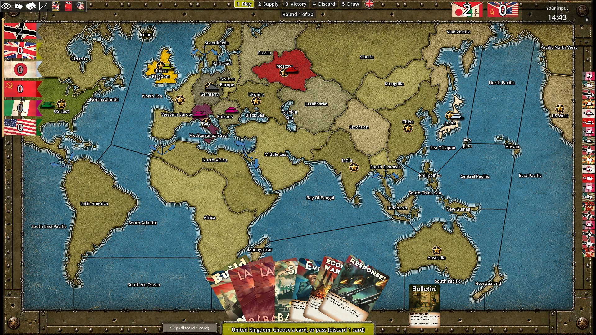

# Style Guide

The visual rules every UI component should follow. Each section records a style as it is
actually built, with the file that owns it, so new work can reuse it instead of re-deriving it.

- [Menu style ("brass on olive")](#menu-style-brass-on-olive) — main menu, screens, dialogs
- [In-game HUD style (current, due for a rework)](#in-game-hud-style-current-due-for-a-rework)

---

## Menu style ("brass on olive")

Introduced in `07360cf`, `8acf7cf`, `8bf6668` and `ca45a2d`. Dark, slightly warm olive glass
over the parallax backdrop, cream text, and brass as the only accent colour. Brass means
"interactive" or "important"; everything else stays neutral.

**Source of truth:** [MenuTheme.tres](scenes/menu/theme/MenuTheme.tres). Set it as the `theme`
on a screen's root card (or the modal shell's `Root`) and every child picks it up. Prefer a
theme type variation over a `theme_override_*` on a node.

### Palette

| Token | Hex | Godot `Color(...)` | Used for |
|---|---|---|---|
| **Brass** | `#D9AD5C` | `0.851, 0.678, 0.361` | Accent: borders, rules, kicker text, focus, slider fill, check/toggle "on" |
| Brass fill | `#D1A455` | `0.82, 0.643, 0.333` | Primary button face |
| Brass fill (hover) | `#EDC26E` | `0.93, 0.76, 0.43` | Primary button face, hovered |
| Spark | `#FFEDBD` | `1, 0.93, 0.74` | BrassFrame highlights (sweep, glint) |
| **Cream** (text) | `#EDE5D1` | `0.929, 0.898, 0.82` | Body text, labels, titles, button text |
| Cream hover | `#F5D18C` | `0.96, 0.82, 0.55` | Text on hover, caret, selected tab |
| Cream pressed | `#FFE6AD` | `1, 0.9, 0.68` | Text while pressed |
| **Muted** | `#B0A894` | `0.69, 0.66, 0.58` | Secondary text, section headers, unselected tabs, placeholders |
| Ink | `#1B170E` | `0.106, 0.09, 0.055` | Text/marks on a brass surface (primary button, check tick, toggle knob) |
| **Olive glass** | `#0C0D0A` | `0.047, 0.051, 0.039` | Card and modal surface (at 74–82% alpha) |
| Popup surface | `#111210` | `0.067, 0.071, 0.055` | Dropdowns, tooltips (97–98% alpha) |
| Scrim | `#050604` | `0.02, 0.024, 0.018` | Over the backdrop: 35% behind cards, 62% (blurred) behind modals |

Transparency does the rest of the work. Neutral lines are white at low alpha, brass lines are
brass at an alpha that rises with emphasis:

| Alpha ladder | White | Brass |
|---|---|---|
| Barely there | 0.04–0.06 (scroll track, disabled border) | 0.06 (tab hover fill) |
| Resting | 0.10–0.14 (button border, tab underline, vertical separator) | 0.25–0.32 (card border, horizontal rule) |
| Active | — | 0.45–0.60 (popup border, focus ring, inset bar) |
| Full | — | 0.85–1.0 (hovered/pressed border, selected tab) |

### Typography

One family, [MenuFontBase.tres](scenes/menu/theme/MenuFontBase.tres): **Bahnschrift** (system
font; falls back to DIN Alternate, Segoe UI, Helvetica Neue, Arial), cut into variations by
OpenType weight/width.

| Variation | File | Settings | Role |
|---|---|---|---|
| Body | `MenuFontBody.tres` | wght 400 | Default for everything (theme `default_font`, size **22**) |
| Body Bold | `MenuFontBodyBold.tres` | wght 700 | `[b]` in RichTextLabel |
| Caps | `MenuFontCaps.tres` | wght 600, +4 letter spacing | Kickers and section headers — always uppercase text |
| Display | `MenuFontDisplay.tres` | wght 700, wdth 75 (condensed), +1 spacing | Titles and button captions — always `uppercase = true` |

Type scale in use:

| Size | Where |
|---|---|
| 96 | Main-menu wordmark (second line in Brass) |
| 60 | `MenuTitle` — screen title |
| 44 | Modal title (`MenuTitle` overridden in `MenuModalShell`) |
| 32 | `MenuCommandButton` caption |
| 28 | `MenuActionButtonPrimary` caption |
| 26 | `MenuActionButton` caption |
| 22 | Body (theme default) |
| 21 | Tabs, dropdown items, inset descriptions |
| 19 | `MenuMuted` |
| 18 | Tooltips |
| 17 | `MenuKicker` |
| 15 | `MenuSection` |

### Theme type variations (labels and panels)

Set with `theme_type_variation` on the node.

| Variation | Base | Look | Use |
|---|---|---|---|
| `MenuKicker` | Label | Caps 17, Brass | Eyebrow line above a title, e.g. `NEW GAME  ·  VERSUS THE AI` (parts joined by two spaces, `·`, two spaces) |
| `MenuTitle` | Label | Display 60, Cream, soft drop shadow (0,3 / 8px, 55% black) | Screen or dialog title, uppercase |
| `MenuSection` | Label | Caps 15, Muted | Header over a group of controls: `SCENARIO`, `OPTIONS`, `PLAY` |
| `MenuMuted` | Label | Body 19, Muted | Hints, secondary info, empty states |
| `MenuInset` | PanelContainer | 30% black, 2px Brass bar on the left (60%), 18×14 padding | Read-only description or callout inside a card |
| `MenuPrimaryButton` | Button | Brass fill, Ink text, Display 22 | The compact primary inside a dialog, notice or toast (see Buttons) |
| `MenuSecondaryButton` | Button | Olive glass, Cream border and text, Display 22 | Cancel / Close / Refresh in a dialog's button row (see Buttons) |

Kicker + Title sit in a `VBoxContainer` with `separation = -4`, followed by an `HSeparator`
(the Brass rule).

### Surfaces

**Card** — the main panel of a full screen (Skirmish, Load Game, Join, Friends' Games, Lobby,
Disclaimer).
- `PanelContainer` → theme `PanelContainer/styles/panel` = `Panel_glass`: Olive glass 74%,
  1px Brass border at 32%, radius 4, padding 32×28.
- `material = FrostedPanel.tres` — the blurred backdrop shows through, tinted by the style's
  own colour (blur LOD 3.5).
- Child `BrassFrame` with `Inset = 14`, `BracketLength = 30–34` (the default animated frame).
- Sits over `ParallaxBackdrop` + a 35% Scrim `ColorRect`.

**Modal** — every dialog, via [MenuModalShell.tscn](scenes/menu/MenuModalShell.tscn).
- Full-screen Dim: frosted, Scrim colour at 62%.
- Panel: Olive glass 82%, Brass border 40%, radius 4; min width 760; content margin 44×34;
  `Box` separation 14; title is `MenuTitle` at 44, centred.
- `BrassFrame` `Inset = 14`, `BracketLength = 30`, `GlowAlpha = 0.22`.

**Popup / tooltip** — Popup surface, 1px Brass border at 45%, radius 3; popups add a 12px
50%-black shadow. Dropdown hover row = Brass 20%.

**Rules**
- Horizontal (`HSeparator`): 1px line, Brass 30%.
- Vertical (`VSeparator`): 1px line, white 10%.
- Main-menu ornament: 72px Brass bar (85%) · ★ in Brass · hairline Brass (25%) to the edge.

Corner radius: **3** for controls, **4** for cards/modals, **2** for popup rows. Nothing rounder
(except toggle pill and slider knob, which are SVGs).

### Buttons

There are three button scenes, all scripted by
[MenuPanelButton.cs](scripts/C#/Menu/MenuPanelButton.cs) (caption via `ButtonText`, click sound,
state tints) and topped by a `BrassFrame`. Captions are Display, uppercase. All use the pointing
hand cursor and sink the caption 2px while held.

| | `MenuCommandButton` | `MenuActionButton` | `MenuActionButtonPrimary` |
|---|---|---|---|
| Role | Main-menu navigation list | Secondary action (Back, Cancel, Refresh) | The one main action of a screen (Start Game, Host, Join) |
| Size | full width × 58 | min 220 × 60 | min 300 × 60 (340 × 64 on Skirmish) |
| Caption | 32, left aligned, margin 26 | 26, centred | 28, centred, Ink |
| Normal | transparent; 3px left bar, white 12% | Olive glass 55%, 1px Cream border 28%, r3 | Brass fill, 1px light-brass border (2px bottom), soft brass shadow 14px |
| Hover | Brass 14% fill; left bar full Brass; caption tinted Cream-hover and eased **10px right** | Brass 16% fill, Brass border 95%; caption tinted Cream-hover | Brass fill (hover), brighter border, shadow 20px |
| Pressed | = hover, caption sinks 2px | = hover, caption sinks 2px | = hover, caption sinks 2px |
| Disabled | left bar white 5%, caption 30% | Olive glass 30%, border white 8%, caption 35% | Dull brass 45%, no shadow, caption pale |
| Focus | none (hover carries it) | Brass ring 60%, 3px outside | Light-brass ring 80%, 3px outside |
| BrassFrame | No brackets/sweep/glow; glint (0.35, every 1.8s) **only while hovered** | Brackets + sweep (200px/s, 60 wide) + glow 0.28, **only while hovered** (`IdleEnergy = 0`) | Brackets + glow 0.25 always on, no sweep; glint 0.7 every 4.5s |

Layout rule: a screen's footer is `[Action ...]  <spacer>  [Primary]` — secondary actions left,
the single primary action on the right. One Primary per screen.

**Plain `Button` / `OptionButton`** (inline controls such as *Randomize*, dropdowns) get the
theme styles: white 5% fill, white 14% border, r3, padding 18×8 → hover Brass 16% + Brass 85%
border, text Cream-hover → pressed Brass 30% + full Brass border, text shifts 1px down → disabled
white 2%/6%. Focus ring Brass 55%, 2px outside. `OptionButton` arrow margin 14. Typical height
50–56.

**Primary comes in two sizes** that share one look: brass face, 1px light-brass border
with a 2px bottom edge, soft brass shadow, Ink caption in Display uppercase, the same hover
brightening and the same light-brass focus ring.

| | Screen primary — `MenuActionButtonPrimary` scene | Dialog primary — `MenuPrimaryButton` variation |
|---|---|---|
| Where | The main action of a full screen (Start Game, Host, Join) | Confirm/accept inside a modal, notice or toast |
| Size | 300 × 60, caption 28 | ~160–260 × 44, caption 22 |
| Shadow | 14px, 20px on hover | 6px, 10px on hover |
| BrassFrame | brackets, glow, periodic glint | none (the modal already has one) |
| Pressed | caption sinks 2px | caption sinks 2px (via content margins) |

**Secondary comes in the same two sizes.** `MenuActionButton` on screens; on dialogs the
`MenuSecondaryButton` variation — 160 × 44, Display 22, Olive glass 55% with a Cream 28% border,
hover Brass 16% fill + Brass border with Cream-hover text, caption sinks 2px when pressed,
Brass focus ring. No BrassFrame. A dialog's button row is then `[SECONDARY ...] [PRIMARY]`
in matching caps. Links like *Host over IP instead* stay a flat, mixed-case `Button`.

A `Button` has no `uppercase` property, so write dialog button text in capitals — in the
scene, and with `ToUpperInvariant()` where code sets it (see `MenuNotice`, `MenuToast`).

### Form controls

| Control | Style |
|---|---|
| `LineEdit` | 35% black fill, white 14% border, r3, padding 14×8. Focus: Brass border 90%. Read-only: 18% black, white 6% border. Placeholder Muted 60%, caret Cream-hover, selection Brass 35%. Height ~50. |
| `CheckBox` | 26px SVG: Brass square with Ink tick (on) / outline (off). Label gap 12. Label turns Cream-hover on hover. |
| `CheckButton` (toggle) | 46×26 pill SVG: Brass with Ink knob (on). For on/off settings. |
| `HSlider` | 6px track white 14%, fill Brass 90%, r3. Knob: 22px Cream disc with Brass ring (brighter on hover). |
| `TabContainer` | No panel. Tabs: padding 20×8/10, 2px underline — unselected white 10%, hovered Brass 45% + 6% fill, selected full Brass + 10% fill. Text Muted → Cream-hover. Size 21. Tab bar has a 2px white 8% baseline. |
| `VScrollBar` | Track white 4%, grabber Brass 35% → 70% on hover/drag, r3, 6px wide. |

Settings rows: `HBoxContainer` separation 16, label `size_flags_horizontal = 3` (fills), control
fixed width on the right (e.g. 380 for dropdowns). Rows within a group separated by 4.

### BrassFrame (the animated trim)

[BrassFrame.cs](scripts/C#/Menu/BrassFrame.cs) + [BrassFrame.gdshader](scenes/menu/theme/BrassFrame.gdshader):
a `ColorRect` added as the **last child** of a card, modal panel or button. It grows itself by
`Inset` on every side and draws, all in Brass/Spark:

- **Brackets** — L-shaped corner marks standing 4px off the edge (`BracketLength`, `BracketAlpha`).
- **Sweep** — a light travelling round the border (`SweepSpeed` px/s, `SweepWidth`, `SweepAlpha`).
- **Glow** — a soft outer halo breathing on a 4s cycle (`GlowAlpha`).
- **Sheen** — a diagonal glint across the face every `SheenPeriod` s (`SheenAlpha`, off by default).

On a button, everything is scaled by hover energy (eases at 4/s): `IdleEnergy = 1` means always
alive, `0` means dark until hovered or focused. Disabled buttons are always dark. Each instance
starts at a random phase so neighbours don't pulse in sync.

Presets in use:

| Host | Inset | Brackets | Sweep | Glow | Sheen | Idle |
|---|---|---|---|---|---|---|
| Card / modal | 14 | 30–34 | default (260 px/s) | 0.18–0.22 | — | 1 |
| Action button | 8 | 12 | 200 px/s, 60 | 0.28 | — | 0 |
| Primary button | 8 | 12 | off | 0.25 | 0.7 / 4.5s | 1 |
| Command button | 6 | off | off | off | 0.35 / 1.8s | 0 |

Motion stays subtle: nothing moves faster than the sweep, and only hovered or primary elements
glint.

### Spacing

Values used across the menu scenes (VBox/HBox `separation`):

| Value | Use |
|---|---|
| -4 | Kicker → Title |
| 4 | Rows within a setting group |
| 6 | Main-menu command list |
| 10–16 | Controls in a column / section (16 most common) |
| 22–24 | Between major blocks of a card (header, body, footer) |
| 48 | Between card columns |

Spacer `Control`s add 8–14 before a new section and 34 between the main-menu title and the
command list. Card inner margin 24×12 on top of the panel's 32×28 padding.

### Building a new menu screen — checklist

1. `ParallaxBackdrop` + Scrim (35%), then a centred `PanelContainer` card with
   `material = FrostedPanel.tres` and `theme = MenuTheme.tres`.
2. Header: `MenuKicker` + `MenuTitle` (separation -4), then an `HSeparator`.
3. Group controls under `MenuSection` labels; use `MenuInset` for descriptive text.
4. Footer: `MenuActionButton`s left, spacer, one `MenuActionButtonPrimary` right.
5. Add a `BrassFrame` (`Inset = 14`, `BracketLength = 30–34`) as the card's last child.
6. Dialogs instead go through `MenuModalShell` — don't build a new frame.
7. No new colours: pick from the palette and the alpha ladder above.

### Known leftovers

- [MenuPanelButton.tscn](scenes/menu/MenuPanelButton.tscn) is the old nine-patch button (art
  frame, no brass). No menu screen uses it any more, but the in-game UI still does (main HUD,
  chat, players panel, history popup, trigger context). New menu work should use the three
  button scenes above.
- Root-level `MenuPanelBackground.tres`, `MenuTab*.tres` and `SimpleModalStyle.tres` predate the
  theme and are only used by the in-game UI.

---

## In-game HUD style (current, due for a rework)

A snapshot of the HUD as of November 2026, kept brief on purpose: it's expected to change, so this
records the starting point rather than a spec to follow.

**Overall look:** a "war room table". The map sits in a riveted, weathered olive-metal frame
(`Board9Patch*.png`, plus the procedural `WarPanelMaterial` — dark olive base, stains, scratches,
grain). Paper and print props sit on top: fanned cards, the *Bulletin!* card, cloth faction
pennants, flag stamps.

**What's on screen:**

| Area | Element | Look today |
|---|---|---|
| Top left | Toolbar (eye, cards, deck, score history, faction flags) | Small white icons on a dark translucent strip |
| Left edge | Faction pennants | Cloth flags on a pole, big white score numerals, tails tucked behind |
| Top centre | Turn steps (1 Play · 2 Supply · 3 Victory · 4 Discard · 5 Draw) | Plain text; current step in a pill tinted with the active faction's colour |
| Top centre | Round tracker | Small dark plate, "Round 1 of 20" |
| Top right | Team scores | Axis/Allies flag tiles with large white numerals |
| Top right | Input timer | "Your input" over a countdown, white on dark |
| Right edge | Card/round strip | Column of small flag thumbnails |
| Bottom centre | Hand | Fanned full-art cards |
| Bottom centre | Prompt bar | Wide bar tinted in the active faction's colour, dark text: *"United Kingdom: Choose a card…"* |
| Bottom left of prompt | Pass/skip | Small dark button, "Skip (discard 1 card)" |
| Overlays | Modals, history popup, chat, players panel, trigger context | Grey translucent box with a grey border (`SimpleModalStyle.tres`), or the old nine-patch art frame |

**Type:** no theme is set on the HUD, so text uses Godot's default sans in white or light grey,
usually with a dark outline or shadow for legibility over the map. Map labels are a separate
condensed face with a light outline.

**Colour:** mostly neutral — dark translucent greys (`#1A1A1A` at 60–88%), white/light-grey text,
white borders at ~25%. The strongest accent is the **active faction's colour** (`TurnFactionTint`,
80% alpha) on the current turn step and the prompt bar. A few one-off golds and browns appear in
single widgets.

**Buttons:** the legacy `MenuPanelButton` (nine-patch art frame) and plain default-theme Buttons.

**How it differs from the menu style:**
- No shared theme, so fonts, sizes and panel styles are set widget by widget.
- Neutral grey panels instead of olive glass; no brass accent or BrassFrame.
- The frame and props are textured and skeuomorphic, while the menu is flat glass with a thin trim.
